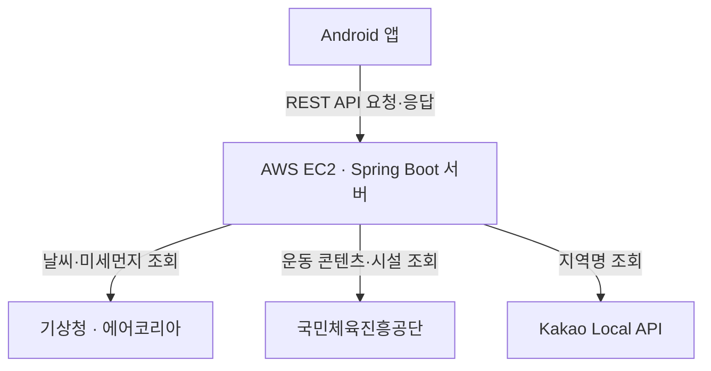

# SpoSwitch | 스포스위치

### 날씨가 바뀌면, 운동도 스위치!

**SpoSwitch는 국민체육진흥공단 공공데이터 활용 공모전을 위해 개발한 Android 앱입니다.**

날씨와 미세먼지에 따라 **오늘 운동할 장소를 실내·야외로 바꿔 추천**하고, 사용자에게 맞는 운동 영상과 가까운 체육시설을 함께 제공합니다.

서울 지역을 대상으로 하며, 로그인 없이 자신의 운동 정보를 입력하고 바로 이용할 수 있습니다.

[📱 APK 다운로드](https://github.com/won1203/SpoSwitch/releases/tag/v1.0.2)

## 주요 기능

### 1. 시작하기

앱을 실행하고 위치 권한을 허용하면 현재 위치를 기준으로 날씨와 주변 시설을 불러옵니다. 이후 자신의 연령대를 선택합니다.

| 시작 화면 | 위치 권한 | 연령대 선택 |
| :---: | :---: | :---: |
|  |  |  |
| 날씨와 주변 시설을 불러옵니다. | ‘앱 사용 중에만 허용’을 누르세요. | 내 연령대를 고릅니다. |

### 2. 내 상태 입력

체력 수준과 운동 목적, 선호하는 운동 장소를 입력합니다. **‘날씨에 맞게 추천’**을 선택하면 날씨와 미세먼지에 맞춰 운동 장소를 추천합니다.

| 체력 수준 | 운동 목적 | 운동 장소 |
| :---: | :---: | :---: |
|  |  |  |
| 평소 운동 횟수로 고릅니다. | 가장 중요한 목적 하나를 고릅니다. | ‘날씨에 맞게 추천’을 권장합니다. |

### 3. 오늘의 추천

현재 날씨와 미세먼지, 운동 장소를 추천하는 이유를 확인합니다. 추천에 맞는 주변 시설을 살펴보고 지도와 목록에서 원하는 시설을 찾을 수 있습니다.

| 날씨와 추천 | 가까운 시설 | 시설 탭 |
| :---: | :---: | :---: |
|  |  |  |
| 현재 날씨·미세먼지와 추천 이유가 나옵니다. | 추천에 맞는 실내·야외 시설을 거리순으로 보여 줍니다. | 반경 3km 시설을 지도·목록으로 찾습니다. |

### 4. 운동하기

입력한 조건에 맞는 **국민체력100 운동 영상**을 확인하고 앱 안에서 재생할 수 있습니다. 운동 계획서에서는 연령대별 주차 프로그램을 살펴볼 수 있습니다.

| 맞춤 운동 영상 | 영상 재생 | 운동 계획서 |
| :---: | :---: | :---: |
|  |  |  |
| 내 조건에 맞는 국민체력100 영상 목록입니다. | 앱 안에서 재생하고 10초 앞뒤로 이동할 수 있습니다. | 연령대별 주차 프로그램을 봅니다. |

### 5. 내 상태

입력한 **연령대·체력 수준·목적·장소**를 확인하고 수정합니다.

‘내 운동 동네’를 누르면 서울 지역을 직접 고를 수 있으며, 입력한 정보는 휴대폰에만 저장됩니다.

## 사용 기술 스택

| 구분 | 기술 |
|---|---|
| Android 앱 | Kotlin, Android View, ViewBinding, Material Components |
| 백엔드 | Java 21, Spring Boot, Spring MVC |
| 지도 | Kakao Maps Android SDK |
| 사용자 정보 저장 | SharedPreferences |
| 외부 API 연동 | Java HttpClient, Jackson |
| 서버 | AWS EC2 |
| 빌드·버전 관리 | Gradle, Git, GitHub |

## 사용한 공공데이터 API

| 제공 기관 | API | 앱에서의 활용 |
|---|---|---|
| 국민체육진흥공단 | 전국체육시설 API | 주변 체육시설 검색, 시설 상세 정보 및 지도 표시 |
| 국민체육진흥공단 | 국민체력100 동영상 정보 API | 운동 영상 추천 및 연령대별 표준운동 프로그램 제공 |
| 기상청 | 단기예보 조회서비스 — 초단기예보 | 기온·강수·풍속 등 날씨 정보 조회 및 운동 장소 추천 |
| 한국환경공단 에어코리아 | 대기오염정보 조회서비스 | 미세먼지·초미세먼지 정보 조회 및 실내외 추천 판단 |

추가로 **Kakao Local API**를 이용해 좌표에 해당하는 지역명을 조회하고, **Kakao Maps SDK**로 시설 위치를 표시합니다.

## 서버 구성 — AWS EC2 연동

Android 앱은 **AWS EC2에 배포한 Spring Boot 서버**와 통신합니다. 서버는 공공데이터 API에서 정보를 조회하고, 앱에서 사용할 날씨·운동 콘텐츠·시설 정보로 가공해 제공합니다.

| 항목 | 구성 |
|---|---|
| 운영 환경 | AWS EC2, 서울 리전 |
| 서버 이름 | `sposwitch-server` |
| 서버 역할 | 외부 API 연동, 운동 콘텐츠 추천, 주변 시설 조회 |
| 데이터 관리 | 시설·운동 콘텐츠·대기정보를 서버 메모리에 캐시 |
| 사용자 정보 | 별도 DB 없이 Android 기기에 저장 |

외부 API의 반복 호출을 줄이기 위해 조회 데이터를 일정 시간 재사용합니다. 시설 데이터를 새로 불러오는 과정에서 오류가 발생하더라도 기존 데이터가 있으면 계속 제공하도록 구성했습니다.

자세한 로컬 실행 방법은 [백엔드 실행 안내](docs/백엔드-실행-안정화.md)를 참고하세요.
